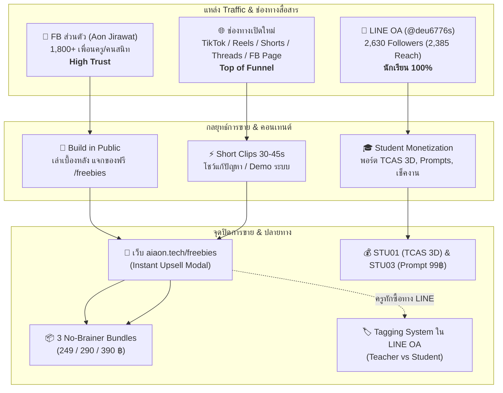

# 🧠 iAon Tech: Permanent Core Strategy Memory (บันทึกความทรงจำถาวรของโปรเจกต์)

> **File Location:** `C:\iAonDev2026\docs\strategy\IAON_CORE_STRATEGY_MEMORY.md`  
> **Master Sync:** `c:\Users\ACER\OneDrive\WORK_SPACE\02_TECH\01_STRATEGY\IAON_CORE_STRATEGY_MEMORY.md`  
> **Status:** 🔒 Permanent Strategic Knowledge (กฎเหล็กและยุทธศาสตร์หลักที่ AI และทีมงานทุกคนต้องยึดถือตลอดชีพ)  
> **Last Updated:** 2026-10-18

---

## 1. 🌟 Brand & Founder Profile (ข้อมูลแบรนด์และผู้ก่อตั้ง)

- **แบรนด์ทางการ:** **iAon Tech** (บริษัท/แพลตฟอร์ม AI & Automation อัจฉริยะ)
- **เว็บไซต์หลัก (Production Live):** [https://www.aiaon.tech](https://www.aiaon.tech)
- **สโลแกน:** *"ไอทีง่ายๆ สไตล์ไอ้อ้น"* (Democratizing AI & Automation for Everyday Heroes)
- **ผู้ก่อตั้ง & สถาปนิกโครงสร้าง (Founder & Architect):**
  - **ครูจิรวัฒน์ เดชเส้ง (ครูอ้น / iAon)**
  - ข้าราชการครู ตำแหน่ง ค.ศ.2 (ดนตรีสากล) โรงเรียนหาดใหญ่วิทยาลัย (ญ.ว.)
  - AI & Automation Architect / Full-Stack Developer
  - ประสบการณ์พัฒนาระบบโรงเรียน, แพลตฟอร์มดิจิทัล, บอทอัตโนมัติ และเวิร์กโฟลว์ AI
- **สถานะแพลตฟอร์มเว็บไซต์ (Next.js 16 Production Ready):**
  - ครบสมบูรณ์ 102/102 Routes Live สไตล์ Dark Space Cyberpunk Glassmorphism
  - อัปเกรดระบบ **Zero-Tech Funnel** พร้อมใช้งาน 100%
  - **3 No-Brainer Bundles:** รวมระบบยอดฮิตราคาเร้าใจ ปิดการขายไว (249 / 290 / 390 ฿)
  - **Setup Tier Filter System:** จำแนกระดับความง่าย (`zero-tech`, `easy-setup`, `vip-enterprise`) พร้อมแบดจ์นีออน
  - **Freebies Instant Upsell Funnel:** ดาวน์โหลดไฟล์ฟรีปุ๊บ เสนอข้อเสนออัปเกรดทันทีในโมดอล
  - **Frictionless Trust Badges:** ชูความมั่นใจ จัดส่งอัตโนมัติใน 10 วินาทีผ่าน AI Slip Verification
  - **LINE Green CTA Official Theme:** ปุ่มสั่งซื้อทั่วทั้งเว็บใช้รหัสสีเขียว `#06C755` เชื่อมโยง LINE OA ทันที

---

## 2. 🚨 กฎเหล็กการแยกกลุ่มเป้าหมายตามแพลตฟอร์ม (CRITICAL AUDIENCE SEGMENTATION)

> [!CAUTION]
> **กฎเหล็กข้อห้ามเด็ดขาด (Absolute Non-Negotiable Rule):**  
> ฐานผู้ติดตามเดิมใน LINE OA คือ **"กลุ่มนักเรียน 100%"** ห้ามบรอดแคสต์ขายระบบงานเอกสารครู (ปพ.5, ว.PA, แบบประเมินครู) ยิงตรงใส่ฐานนักเรียนเดิมเด็ดขาด หากฝ่าฝืนจะนำไปสู่การกด Block มหาศาลและทำลายความสัมพันธ์กับนักเรียน!

### 🟢 กฎและยุทธศาสตร์การใช้แต่ละแพลตฟอร์ม

---

### A. LINE OA (`@deu6776s` — ผู้ติดตาม 2,630 คน / Reach 2,385 คน)

1. **ลักษณะประชากรและบริบทดั้งเดิม:**
   - ผู้ติดตามเดิมทั้ง 2,630 คนคือ **"นักเรียนโรงเรียนหาดใหญ่วิทยาลัย (ญ.ว.) 100%"** ซึ่งแอดไลน์เพื่อติดตามคะแนน ตรวจสอบงานค้าง และรับข่าวสารวิชาดนตรีสากล
2. **แนวทางการบรอดแคสต์ (Broadcast Policy):**
   - **ห้ามเด็ดขาด:** การบรอดแคสต์ขายเอกสารครู, ปพ.5, ระบบ PA, หรือสื่อสำหรับผู้บริหารโรงเรียน
   - **อนุญาตและแนะนำ:** บรอดแคสต์เนื้อหาที่เป็นประโยชน์ต่อการเรียน, การใช้ AI ช่วยทำการบ้าน, ทริคสอบ, ข่าวเปิดเทอม, และสินค้าสำหรับนักเรียน
3. **พอร์ตสินค้าทำเงินจากฐานนักเรียน (Student Monetization Portfolio):**
   - 🏆 **`STU01`: เว็บไซต์ Portfolio TCAS 3D เสมือนจริง:**
     - เว็บไซต์พอร์ต 3 มิติแนว Cyberpunk Glassmorphism หมุนดูผลงานได้บนสมาร์ตโฟน
     - เหมาะอย่างยิ่งสำหรับนักเรียน ม.ปลาย ที่ต้องยื่น Portfolio รอบ 1 TCAS (ช่วงทองคำ: ต.ค. - ธ.ค.)
   - ⚡ **`STU03`: คัมภีร์ AI Prompts สำหรับนักเรียน (99 ฿):**
     - สินค้าราคา Impulse Buy (ซื้อง่าย จ่ายไว ไม่ต้องคิดนาน)
     - รวม Prompt ช่วยสรุปบทเรียนยาวๆ ทำชีตสรุป ติวสอบ ตะลุยโจทย์ และช่วยจัดตารางอ่านหนังสือ
   - 📋 **`STU02`: ระบบเช็คการบ้าน & ติดตามงานค้างประจำห้องเรียน (99 ฿):**
     - ระบบกูเกิลชีตและแดชบอร์ดที่หัวหน้าห้องหรือตัวแทนใช้เช็กงานเพื่อนในห้องได้อัตโนมัติ
   - 🎸 **คอร์สเรียน & กิจกรรมใน Academy (`aiaon.tech/academy`):**
     - เวิร์กช็อปดนตรี, การแต่งเพลงด้วย AI, การเขียนโค้ดเบื้องต้น
   - 🎧 **Affiliate Gadgets & อุปกรณ์ไอที:**
     - ป้ายยาหูฟัง, แท็บเล็ต, สไตลัส, ไมโครโฟนสำหรับเรียนออนไลน์ผ่าน TikTok Shop / Shopee
4. **ระบบแยกกลุ่มลูกค้าครูใหม่ (Teacher vs Student Tagging):**
   - เมื่อมีคุณครูหรือลูกค้าภายนอกคลิกสั่งซื้อระบบจากหน้าเว็บ `aiaon.tech` เข้าสู่ LINE OA
   - ให้ติดแท็กแยกกลุ่มทันที:
     - 🏷️ Tag `Customer: Teacher` สำหรับคุณครูและบุคลากรการศึกษา
     - 🏷️ Tag `Customer: Student` สำหรับนักเรียน
     - 🏷️ Tag `Customer: General/SME` สำหรับบุคคลทั่วไปหรือผู้ประกอบการ
   - เมื่อแยกแท็กชัดเจน ในอนาคตจึงสามารถใช้งาน **Segmented Broadcast** ยิงโปรโมชันคุณครูเฉพาะกลุ่มที่มีแท็ก `Customer: Teacher` ได้ 100% ปลอดภัย ไม่รบกวนนักเรียน

---

### B. Facebook ส่วนตัว (`Aon Jirawat` — เครือข่าย 1,800+ คน)

1. **ลักษณะกลุ่มผู้ฟัง:**
   - เพื่อนครู, ผู้บริหาร, ครูร่วมรุ่น, บุคลากรทางการศึกษา, และคนสนิทที่มีความเชื่อมั่นและไว้วางใจสูง (High Trust Base)
2. **กลยุทธ์หลัก: Build in Public (เปิดเผยเบื้องหลังการพัฒนา):**
   - ไม่โพสต์ขายตรงแบบ Hard Sale แต่เล่าสตอรี่เบื้องหลังความเหนื่อยยากของการทำเอกสาร แล้วโชว์ว่าเราแก้ปัญหานั้นด้วยโค้ดและ AI อย่างไร
   - แจกของฟรีจากหน้าเว็บ [aiaon.tech/freebies](https://www.aiaon.tech/freebies) ให้เพื่อนครูไปลองใช้ฟรี
   - ปล่อยให้ระบบ **Instant Upsell Funnel** บนหน้าเว็บทำหน้าที่แนะนำ **3 มหาบันเดิล (249 / 290 / 390 ฿)** ให้โดยอัตโนมัติ
   - แนบลิงก์เชิญชวนเพื่อนๆ ไปกดติดตามเพจใหม่ **AiAon Tech** อย่างเป็นธรรมชาติ

---

### C. ช่องทางเปิดใหม่ (FB Page: AiAon Tech, TikTok, IG Reels, YouTube, Threads)

1. **บทบาททางธุรกิจ:**
   - ทำหน้าที่เป็น **Top-of-Funnel (บ่อดัก Organic Traffic จากคนแปลกหน้าทั่วประเทศ)**
   - เป้าหมาย: ดึงดูดครูทั่วประเทศ, ผู้สอบบรรจุครูผู้ช่วย, นิสิตนักศึกษาฝึกสอน, และผู้ประกอบการ SMEs
2. **รูปแบบคอนเทนต์:**
   - คลิปสั้น 30–60 วินาที เน้น Visual Impact ชัดเจน:
     - ก่อนใช้ (ปวดหัวกับชีตสูตรพัง/นั่งกรอกข้ามคืน) vs หลังใช้ (คลิกเดียวออกเกรด/เด้งผลสอบทันที)
     - โชว์มุม Studio Rig สไตล์ Cyberpunk และการทำงานของระบบอัตโนมัติ 0 วินาที
   - Call to Action (CTA) สม่ำเสมอ: *"แจกฟรีที่ aiaon.tech หน้า freebies ลิงก์ในโปรไฟล์"* เพื่อนำ Traffic เข้าสู่ Sales Funnel บนเว็บไซต์

---

## 3. 📦 Product Matrix & Sales Funnel Ecosystem (ผังโครงสร้างสินค้าและราคา)

| รหัสสินค้า | ชื่อสินค้า / ชุดบันเดิล | กลุ่มเป้าหมาย | ราคาโปรโมชัน | ช่องทางขายหลัก |
|---|---|---|---|---|
| **BUNDLE-01** | **ชุดเอาตัวรอดครูประจำชั้น** (SYS09, AONE09, STU02, SYS27) | ครูประจำชั้น / ครูทั่วไป | **249 ฿** (ลด 58%) | หน้าแรก, Vault, Freebies Upsell |
| **BUNDLE-02** | **ชุดทางลัดปิดเทอมไว & ว.PA** (SYS02 ปพ.5, SYS05, SYS11 + BGM-01) | ครูผู้สอนทุกระดับ | **290 ฿** (ลด 61%) | หน้าแรก, Vault, Short Clips |
| **BUNDLE-03** | **ชุดสอบติดครูผู้ช่วยฉบับเร่งรัด** (เพลงจำ MUS-01 10 เพลง + บอท Telegram VIP PREP01) | ผู้สอบครูผู้ช่วย | **390 ฿** (ลด 43%) | เพจสอบครู, TikTok, Teacher Prep |
| **STU01** | **เว็บไซต์ Portfolio TCAS 3D** (เทมเพลต & รับจัดทำพอร์ต 3D) | นร. ม.ปลาย / ยื่น TCAS รอบ 1 | **เริ่มต้น 99 - 590 ฿** | LINE OA, TikTok, Student Vault |
| **STU03** | **คัมภีร์ AI Prompts นักเรียน** (ทำการบ้าน / สรุปชีต / ติวสอบ) | นักเรียนทุกระดับ | **99 ฿** | LINE OA, Freebie Upsell |
| **SYS02** | **ระบบตัดเกรด & ปพ.5 ดิจิทัล** (คำนวณอัตโนมัติใน 1 คลิก) | ครูผู้สอน | **199 ฿** | Freebies Upsell, Vault |
| **PREP01** | **AiAon Prep VIP Bot Pass** (บอท Telegram 1,500 ข้อ + เฉลย AI) | ผู้สอบครูผู้ช่วย | **290 ฿** | Teacher Prep, Telegram |
| **AIC01** | **AI Caretaker Service** (บอทเฝ้าร้าน AI ตรวจสลิป 24 ชม.) | ร้านค้าออนไลน์ / SMEs | **รายเดือน/ระบบ** | Services, Studio Demo |

---

## 4. 🛡️ Brand Tone & Design Identity (อัตลักษณ์และบุคลิกแบรนด์)

1. **บุคลิกของ iAon Tech:**
   - เป็นมิตร, จริงใจ, ตรงไปตรงมา, มีมุกตลกสไตล์ครูไอ้อ้น
   - ไม่ใช้ศัพท์เทคนิคซับซ้อน อธิบายเรื่องยากให้กลายเป็นเรื่องง่าย
   - เน้น *"ซื้อไปแล้ว ใช้ได้จริงใน 3 นาที ไม่ต้องปวดหัวเขียนโค้ด"*
2. **Theme UI/UX:**
   - Dark Space Glassmorphism: พื้นหลังสีมืดอวกาศ (`#050814`) ผสานแสงนีออน Cyberpunk (Cyan, Violet, Emerald, Amber, Rose)
   - แบดจ์เรืองแสงและเอฟเฟกต์ไฟฉายนีออน Radial Spotlight บนการ์ดทุกใบ
   - ปุ่มสั่งซื้อ LINE Official สีเขียวมาตรฐาน `#06C755` คมชัด เด่นสง่า น่าเชื่อถือ
